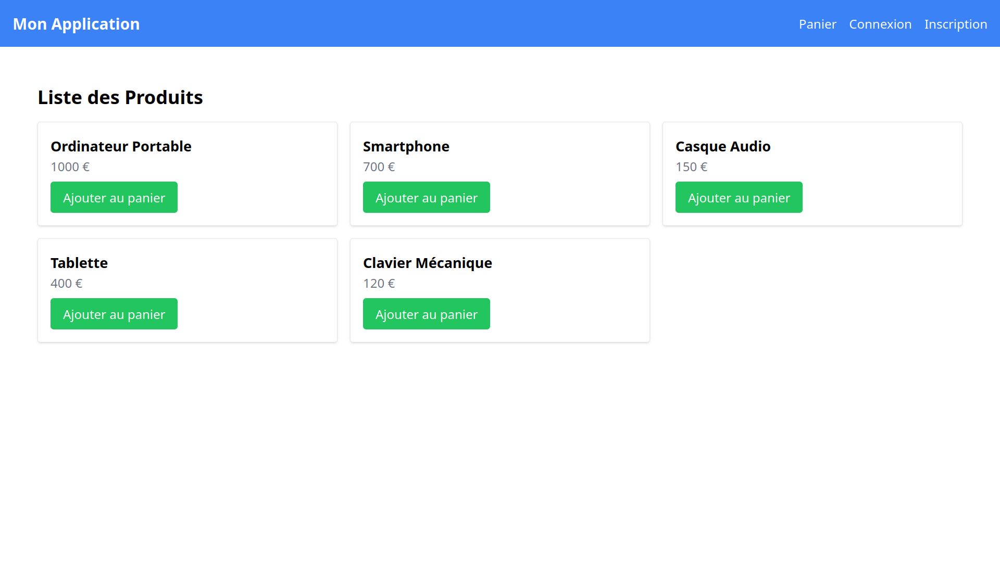
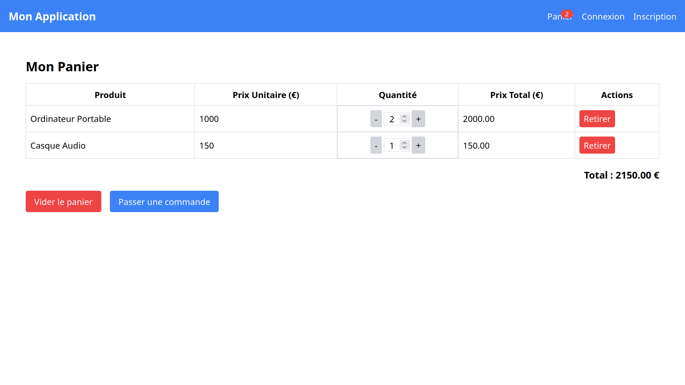
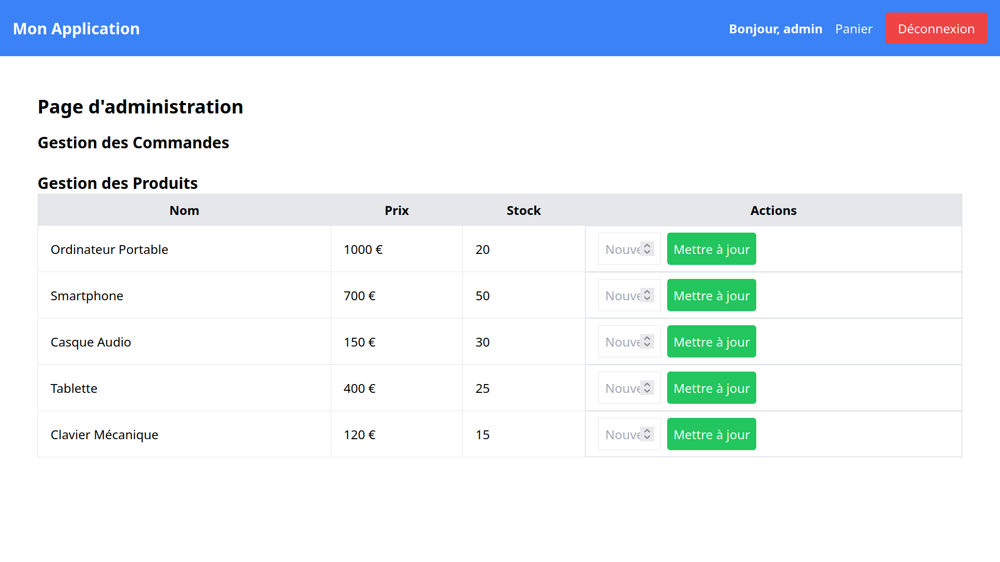
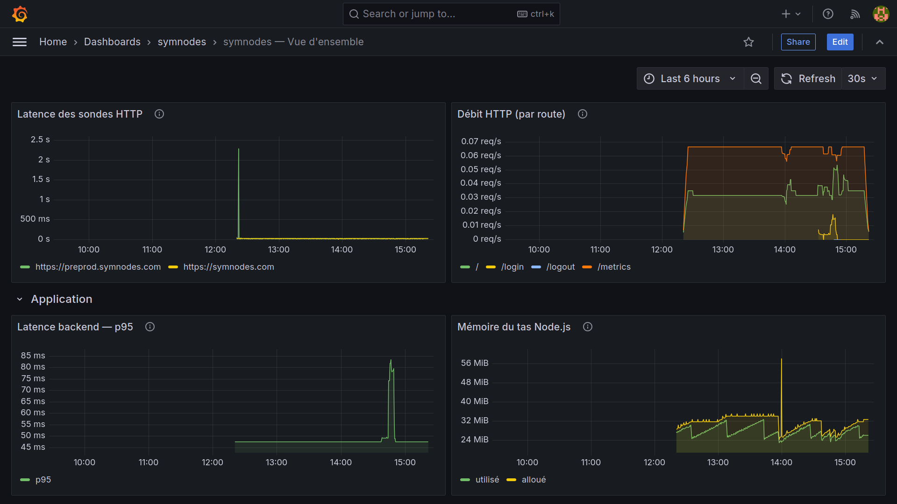
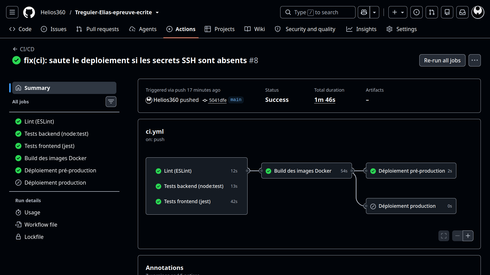

# Document de rendu — Épreuve écrite Cloud-Campus

> **Document à transmettre** avec le projet.
> Il est **distinct du dossier `RESSOURCES/`** (qui contient le cahier des charges,
> le tableau de compétences et le registre des corrections).
>
> La section « Séquences » est **générée automatiquement** (`npm run rendu`) ; les
> captures d'écran et les accès sont à compléter manuellement.

---

## 1. Présentation

Application e-commerce **MERN** (React / Express / MongoDB) conteneurisée via Docker,
avec gateway et microservices (notifications, gestion du stock). Mise en production sur
un homeserver, exposee via le domaine `symnodes.com`.

## 2. Infrastructure

| Élément | Valeur |
|---------|--------|
| Hébergement | Homeserver (auto-hébergé, IP publique statique `176.176.123.209`) |
| Pré-production | `preprod.symnodes.com` (même serveur, stack Docker isolée) |
| Production | `symnodes.com` / `www.symnodes.com` |
| Reverse-proxy + TLS | Caddy (Let's Encrypt automatique) |
| Base de données | MongoDB (volume persistant, non exposée publiquement) |
| Supervision | Prometheus + Grafana + Alertmanager (+ node-exporter, cAdvisor, blackbox) |
| CI/CD | GitHub Actions (lint, tests, build images, déploiement pré-prod/prod) |
| Journalisation | Winston (services) + piste d'audit applicative (`logs/audit.log`) |

## 3. Séquences détaillées (généré automatiquement)

<!-- AUTO:SEQUENCES:START -->
| Date | Commit | Tâche réalisée |
|------|--------|----------------|
| 2026-11-03 | `eb6fd65` | first commit |
| 2026-11-03 | `6011025` | chore: baseline du projet (import initial) |
| 2026-11-03 | `971e4af` | fix(security): ne plus journaliser les secrets et tokens |
| 2026-11-03 | `9c1515d` | fix(security): restreint CORS aux origines autorisées |
| 2026-11-03 | `4187694` | fix(order): implémente deleteOrder et protège la route DELETE |
| 2026-11-03 | `6f0fe59` | fix(order): implémente validateOrder et corrige le statut hors enum |
| 2026-11-03 | `a1e73c4` | fix(front): retire les logs sensibles et rend l'URL d'API configurable |
| 2026-11-03 | `9be674e` | docs: registre des corrections (fournée 1, C1..C5) |
| 2026-11-03 | `3d82583` | docs(rapport): hébergement, zone DNS symnodes.com et exposition (E21/E23) |
| 2026-11-03 | `e4215b1` | refactor(config): rend les URLs/ports de services configurables |
| 2026-11-03 | `cdd3828` | build(docker): ajoute les Dockerfiles des services Node |
| 2026-11-03 | `04c843a` | build(docker): conteneurise le frontend (React build + Nginx) |
| 2026-11-03 | `3caadfe` | build(compose): stack de production complète (Traefik + app + Mongo) |
| 2026-11-03 | `6775adf` | build(compose): environnements preprod et dev + modele de variables |
| 2026-11-03 | `e21d3fc` | docs: registre des corrections (fournée 2, C6..C10) |
| 2026-11-03 | `9583cbe` | docs: README racine (présentation, architecture, environnements, déploiement) |
| 2026-11-03 | `9c87114` | fix(stock): retire le require dotenv absent des dependances |
| 2026-11-03 | `804331a` | build(compose): remplace Traefik par Caddy (TLS auto Let's Encrypt) |
| 2026-11-03 | `ef51b0c` | docs: met a jour les references Traefik -> Caddy + registre C11/C12 |
| 2026-11-03 | `fac0dbe` | chore(lint): ajoute ESLint (flat config) et Prettier |
| 2026-11-03 | `a236cb6` | feat(validation): valide les entrées utilisateur avec Joi |
| 2026-11-03 | `6274d44` | feat(auth): stocke le JWT dans un cookie HTTPOnly (fini localStorage) |
| 2026-11-03 | `9255a91` | feat(logging): journalisation centralisee avec Winston |
| 2026-11-03 | `ec5c4dc` | feat(flash): messages temporaires via connect-flash |
| 2026-11-03 | `39ce46f` | chore(deps): met a jour les dependances (npm audit) |
| 2026-11-03 | `da08fb8` | docs: registre des corrections (fournee 3, C13..C18) |
| 2026-11-03 | `7977b62` | refactor: supprime le code mort (doublons admin, microservice vide, fichiers orphelins) |
| 2026-11-03 | `946c5ea` | feat(stock): gere le stock en base dans le microservice dedie |
| 2026-11-03 | `173bf95` | ci: pipeline GitHub Actions + tests |
| 2026-11-03 | `c59f667` | feat(audit): piste d'audit applicative (E25) |
| 2026-11-03 | `5079160` | feat(monitoring): supervision et alertes (E26) |
| 2026-11-03 | `865e981` | chore(security): script de durcissement de l'hote (E22) |
| 2026-11-03 | `8931a1f` | docs(api): generation automatique de la doc d'API depuis le code (E29) |
| 2026-11-03 | `44527a5` | docs(rendu): document de rendu auto-genere (hors RESSOURCES) |
| 2026-11-03 | `ab0c0a5` | docs: registre des corrections (fournee 4, C19..C26) + rapport complet + README |
| 2026-11-03 | `552c8e5` | docs: régénère la documentation générée (api + séquences rendu) |
| 2026-11-03 | `cb62b2f` | Just deleted an unused doc |
| 2026-11-03 | `88c1593` | fix(backend): cree le dossier /app/logs avec les droits USER node |
| 2026-11-03 | `6cdab74` | fix(logging): logger structure pour les microservices et le gateway |
| 2026-11-03 | `8d8fcf6` | docs: documente les corrections C27/C28 (commits 88c1593 et 6cdab74) |
| 2026-11-03 | `c02181d` | docs(readme): ajoute une section Liens utiles (app, admin, supervision, CI/CD, interne) |
| 2026-11-03 | `eb3a9b0` | feat(seed): cree un compte administrateur au seed (E29/E27) |
| 2026-11-03 | `7b0fd85` | feat(monitoring): expose Grafana/Prometheus/Alertmanager sur des sous-domaines (E26) |
| 2026-11-03 | `41dfa79` | docs: registre C29 (admin seed) et C30 (exposition supervision) |
| 2026-11-03 | `ccdf6d0` | docs: zone DNS en wildcard (apex + *) dans README et RAPPORT |
| 2026-11-03 | `36bb2e1` | fix(monitoring): retire les ports hote (conflits) et documente le nom de projet |
| 2026-11-03 | `7763f7a` | fix(monitoring): Alertmanager rend sa config au demarrage (flag expand-env inexistant) |
| 2026-11-03 | `d326da4` | fix(build): copie le code applicatif au nom de node (COPY --chown) |
| 2026-11-03 | `4425473` | fix(frontend): re-resout le backend a chaud via le DNS Docker |
| 2026-11-03 | `e6255af` | build(compose): monte les configurations en repertoire et transmet ADMIN_* |
| 2026-11-03 | `67630bf` | feat(deploy): script de redeploiement idempotent et admin auto-cree |
| 2026-11-03 | `66af5a6` | docs: documente le premier demarrage, les comptes admin et les 4 corrections |
| 2026-11-03 | `3ad717e` | chore(env): aligne les valeurs d'exemple du .env.example |
| 2026-11-03 | `201dbbc` | docs(readme): corrige la zone DNS (enregistrements + serie SOA) |
| 2026-11-03 | `b7b5645` | docs(rendu): coche la checklist et ajoute les captures d'ecran |
| 2026-11-03 | `227e8a9` | fix(ci): installe les dependances backend avant les tests |
| 2026-11-03 | `5484086` | docs(readme): restaure l'apex et les proprietaires explicites de la zone DNS |
| 2026-11-03 | `9b350fe` | docs(rapport): aligne la zone DNS et l'exposition de la supervision |
| 2026-11-03 | `a611c52` | docs: complete le registre des corrections (n 35 a 38) |

_Séquences générées automatiquement depuis l'historique git le 2026-11-03T14:25:14.768Z (59 commits)._
<!-- AUTO:SEQUENCES:END -->

## 4. Captures d'écran

> À compléter : site en production, pages panier/commande/admin, dashboard Grafana,
> alertes, pipeline GitHub Actions, `docker compose ps`, certificat TLS, etc.

- [x] Page d'accueil (production)

- [x] Parcours panier → commande

- [x] Interface d'administration*

- [x] Dashboard Grafana / supervision

- [x] Pipeline CI/CD (GitHub Actions)

## 5. Accès et identifiants

> À transmettre séparément (ne pas versionner de secrets) : accès serveur, comptes de
> la base de données, compte administrateur de l'application, accès Grafana.
